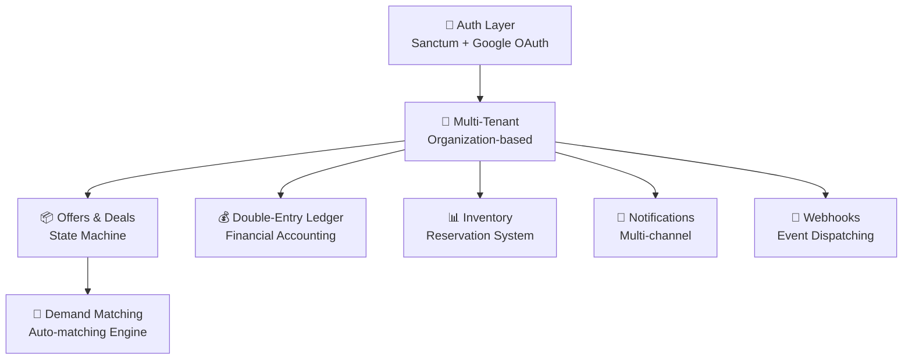
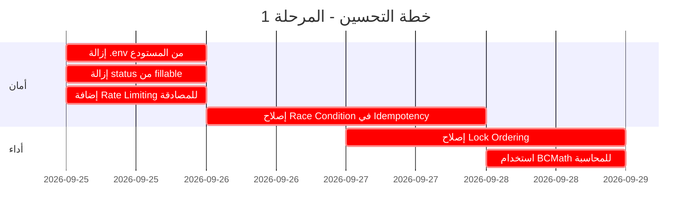

# 📋 تقرير مراجعة الكود الخلفي (Backend Code Review)
## مشروع حصّل — HASSAL B2B Marketplace

> **تاريخ المراجعة:** 24 سبتمبر 2026
> **الإطار:** Laravel 13 — PHP 8.3
> **عدد الملفات المُراجَعة:** +120 ملف (Controllers, Models, Services, Middleware, Routes, Config, Migrations, Seeders, Tests)

---

## 📑 جدول المحتويات

1. [ملخص تنفيذي](#-ملخص-تنفيذي)
2. [نظرة عامة على المشروع](#-نظرة-عامة-على-المشروع)
3. [مشاكل أمنية حرجة](#-مشاكل-أمنية-حرجة)
4. [مشاكل الأداء](#-مشاكل-الأداء)
5. [مشاكل معمارية](#-مشاكل-معمارية)
6. [جودة الكود وأفضل ممارسات Laravel](#-جودة-الكود-وأفضل-ممارسات-laravel)
7. [معالجة الأخطاء](#-معالجة-الأخطاء)
8. [إعدادات البنية التحتية والنشر](#-إعدادات-البنية-التحتية-والنشر)
9. [ملاحظات إيجابية](#-ملاحظات-إيجابية)
10. [خطة التحسين المقترحة بالأولوية](#-خطة-التحسين-المقترحة-بالأولوية)

---

## 🎯 ملخص تنفيذي

| الفئة | الحرج 🔴 | مهم 🟠 | متوسط 🟡 | تحسيني 🟢 |
|--------|-----------|---------|-----------|------------|
| الأمان | 4 | 5 | 3 | 2 |
| الأداء | 2 | 4 | 3 | 2 |
| المعمارية | 1 | 5 | 4 | 3 |
| جودة الكود | 0 | 3 | 6 | 5 |
| البنية التحتية | 1 | 2 | 2 | 1 |
| **المجموع** | **8** | **19** | **18** | **13** |

> [!IMPORTANT]
> المشروع مبنيّ بمستوى هندسي متقدم وتوثيق ممتاز. أغلب المشاكل المذكورة هي تحسينات على أساس صلب وليست عيوب في التصميم الأساسي.

---

## 🏗️ نظرة عامة على المشروع

مشروع **حصّل** هو سوق إلكتروني B2B للتبادل التجاري بين الشركات، مبني على Laravel 13 مع الميزات التالية:



| المكون | العدد | الملاحظة |
|--------|-------|----------|
| Controllers | 28 | بعضها ضخم جداً (+1000 سطر) |
| Models | 40 | تغطية شاملة لنطاق العمل |
| Services | 18 | طبقة خدمات جيدة |
| Middleware | 8 | تغطية أمنية جيدة |
| Migrations | 51 | تطور مدروس |
| Feature Tests | 32 | تغطية اختبارية ممتازة |
| Form Requests | 5 | **ناقصة بشدة** |

---

## 🔴 مشاكل أمنية حرجة

### 1. ثغرة Mass Assignment في حقول الحالة والكميات

> [!CAUTION]
> **الخطورة: حرجة** — يمكن لمستخدم ضار تغيير حالة حسابه أو التلاعب بالمخزون.

**الملفات المتأثرة:**
- [User.php](file:///c:/wamp64/www/Hassal_project/backend/app/Models/User.php#L23-L32) — الأسطر 23-32
- [Offer.php](file:///c:/wamp64/www/Hassal_project/backend/app/Models/Offer.php#L142-L172) — الأسطر 142-172

**المشكلة:**

في `User.php`، الحقول `status`، `email_verified_at`، و `phone_verified_at` موجودة في `$fillable`:

```php
// User.php - السطر 23
protected $fillable = [
    'name', 'email', 'phone', 'national_id',
    'status',                // ⚠️ خطر: يسمح بتغيير حالة الحساب
    'password',
    'email_verified_at',     // ⚠️ خطر: يسمح بتخطي التحقق
    'phone_verified_at',     // ⚠️ خطر: يسمح بتخطي التحقق
];
```

في `Offer.php`، الحقول `status`، `available_quantity`، `reserved_quantity`، و `sold_quantity` موجودة في `$fillable`:

```php
// Offer.php - السطر 142
protected $fillable = [
    // ...
    'status',                // ⚠️ يسمح بتغيير حالة العرض مباشرة
    'available_quantity',     // ⚠️ يسمح بالتلاعب بالمخزون
    'reserved_quantity',      // ⚠️ يسمح بالتلاعب بالحجوزات
    'sold_quantity',          // ⚠️ يسمح بالتلاعب بالمبيعات
];
```

**لماذا هذا خطير؟**

إذا تم استخدام `$request->all()` أو `$request->validated()` بدون تحديد الحقول المسموحة في أي Controller، يمكن لمهاجم إرسال `status=active` في طلب التسجيل لتفعيل حسابه مباشرة، أو إرسال `available_quantity=999999` لتضخيم مخزونه.

**التحسين المقترح:**

```diff
// User.php
protected $fillable = [
    'name', 'email', 'phone', 'national_id',
-   'status',
    'password',
-   'email_verified_at',
-   'phone_verified_at',
];

+protected $guarded = ['status', 'email_verified_at', 'phone_verified_at'];
```

```diff
// Offer.php — إزالة الحقول التحكمية من fillable
-   'status',
-   'available_quantity',
-   'reserved_quantity',
-   'sold_quantity',
```

وتحديث هذه الحقول حصرياً من خلال `Services` المخصصة باستخدام `$model->update()` مع تحديد صريح.

---

### 2. مفتاح التشفير `APP_KEY` مكشوف في `.env`

> [!CAUTION]
> **الخطورة: حرجة** — يمنح المهاجم القدرة على فك تشفير الجلسات والبيانات المشفرة.

**الملف:** [.env](file:///c:/wamp64/www/Hassal_project/backend/.env#L3) — السطر 3

```env
APP_KEY=base64:jxCGLYPZHnJmi/Z+azSQZjwVuqjko7BBV2V1F2j9xJc=
```

**المشكلة:**

ملف `.env` يحتوي على مفتاح التشفير الفعلي ومُضمّن في المستودع. هذا المفتاح يُستخدم لتشفير:
- الجلسات (Sessions)
- التوكنات
- أي بيانات مُشفَّرة بـ `encrypt()`

**التحسين المقترح:**

1. إزالة `.env` من المستودع فوراً
2. التأكد من وجود `.env` في `.gitignore`
3. تدوير (تغيير) `APP_KEY` فوراً في بيئة الإنتاج
4. استخدام `php artisan key:generate` في كل بيئة نشر

---

### 3. غياب Rate Limiting على نقاط المصادقة

> [!CAUTION]
> **الخطورة: حرجة** — يُعرِّض النظام لهجمات القوة الغاشمة (Brute Force) وإغراق البريد.

**الملف:** [AuthController.php](file:///c:/wamp64/www/Hassal_project/backend/app/Http/Controllers/Api/V1/AuthController.php#L29-L36)

**المشكلة:**

الدوال `login()`, `register()`, `google()`, و `forgotPassword()` لا تستخدم أي آلية لتقييد المحاولات:

```php
// AuthController.php - لا يوجد throttle
public function login(LoginRequest $request): JsonResponse { ... }
public function register(RegisterRequest $request): JsonResponse { ... }
public function google(GoogleSignInRequest $request): JsonResponse { ... }
```

**التحسين المقترح:**

```php
// في routes/api.php
Route::middleware('throttle:5,1')->group(function () {
    Route::post('/auth/login', [AuthController::class, 'login']);
    Route::post('/auth/register', [AuthController::class, 'register']);
    Route::post('/auth/forgot-password', [AuthController::class, 'forgotPassword']);
});

Route::middleware('throttle:10,1')->group(function () {
    Route::post('/auth/google', [AuthController::class, 'google']);
});
```

---

### 4. ثغرة Race Condition في IdempotencyMiddleware

> [!CAUTION]
> **الخطورة: حرجة** — يمكن أن يؤدي إلى تنفيذ مزدوج لعمليات مالية.

**الملف:** [IdempotencyMiddleware.php](file:///c:/wamp64/www/Hassal_project/backend/app/Http/Middleware/IdempotencyMiddleware.php#L34-L53) — الأسطر 34-53

**المشكلة:**

بين لحظة فحص وجود المفتاح (`first()`) ولحظة حفظه (`updateOrCreate()`)، يمكن لطلبين متزامنين تجاوز الفحص:

```php
// السطر 34: فحص الوجود
$existing = IdempotencyKey::where('key', $idempotencyKey)...->first();

// إذا لم يوجد، الطلبان يمرّان معاً
$response = $next($request); // ← يتم تنفيذ العملية مرتين!

// السطر 59: الحفظ (متأخر جداً)
IdempotencyKey::updateOrCreate(...);
```

**التحسين المقترح:**

```php
use Illuminate\Support\Facades\Cache;

// استخدام قفل ذري (Atomic Lock)
$lockKey = "idempotency:{$idempotencyKey}:{$userId}:{$orgId}";
$lock = Cache::lock($lockKey, 30);

if (!$lock->get()) {
    return ApiResponse::error(
        'طلب مكرر قيد المعالجة',
        'IDEMPOTENCY_IN_PROGRESS',
        Response::HTTP_CONFLICT
    );
}

try {
    // التحقق والتنفيذ داخل القفل
    $existing = IdempotencyKey::where('key', $idempotencyKey)...->first();
    if ($existing) { /* إرجاع النتيجة المحفوظة */ }
    
    $response = $next($request);
    // حفظ النتيجة
} finally {
    $lock->release();
}
```

---

### 5. نقص في ترويسات الأمان (Security Headers)

> [!WARNING]
> **الخطورة: مهمة** — يُضعف الحماية ضد هجمات XSS وDowngrade.

**الملف:** [SecurityHeaders.php](file:///c:/wamp64/www/Hassal_project/backend/app/Http/Middleware/SecurityHeaders.php#L30-L38)

**المشكلة:**

الـ Middleware يضيف 3 ترويسات فقط:

```php
$response->headers->set('X-Content-Type-Options', 'nosniff');
$response->headers->set('Referrer-Policy', 'same-origin');
$response->headers->set('X-Frame-Options', 'DENY');
```

**الترويسات الناقصة:**
- `Strict-Transport-Security` (HSTS) — حماية من هجمات Downgrade
- `Content-Security-Policy` (CSP) — حماية من XSS
- `Permissions-Policy` — تقييد الميزات المتاحة للمتصفح

**التحسين المقترح:**

```php
$response->headers->set('X-Content-Type-Options', 'nosniff');
$response->headers->set('Referrer-Policy', 'same-origin');
$response->headers->set('X-Frame-Options', 'DENY');
// إضافات مطلوبة:
$response->headers->set('Strict-Transport-Security', 'max-age=31536000; includeSubDomains');
$response->headers->set('Content-Security-Policy', "default-src 'none'; frame-ancestors 'none'");
$response->headers->set('Permissions-Policy', 'camera=(), microphone=(), geolocation=()');
```

---

### 6. تسريب التفاصيل التقنية في رسائل الأخطاء

> [!WARNING]
> **الخطورة: مهمة** — قد يكشف هيكلة قاعدة البيانات أو المسارات الداخلية.

**الملفات المتأثرة:**
- [PurchaseRequestController.php](file:///c:/wamp64/www/Hassal_project/backend/app/Http/Controllers/Api/V1/PurchaseRequestController.php) — دالة `accept()`
- [InventoryReservationService.php](file:///c:/wamp64/www/Hassal_project/backend/app/Services/InventoryReservationService.php#L50) — السطر 50

**المشكلة:**

```php
// في PurchaseRequestController.php
catch (Exception $e) {
    return ApiResponse::error($e->getMessage(), ...); // ⚠️ تسريب رسالة الخطأ
}

// في InventoryReservationService.php - السطر 50
throw new Exception("Cannot reserve from an offer that is not ACTIVE (Current status: {$lockedOffer->status})");
// ⚠️ يكشف الحالة الداخلية للعرض
```

**التحسين المقترح:**

```php
// تسجيل الخطأ التفصيلي للمطور
Log::error('فشل في قبول طلب الشراء', [
    'error' => $e->getMessage(),
    'trace' => $e->getTraceAsString(),
]);

// إرجاع رسالة عامة للمستخدم
return ApiResponse::error(
    'حدث خطأ أثناء معالجة الطلب. يرجى المحاولة لاحقاً.',
    'PROCESSING_ERROR',
    Response::HTTP_INTERNAL_SERVER_ERROR
);
```

---

### 7. تنظيف غير كافٍ للبيانات الحساسة في Audit Log

> [!WARNING]
> **الخطورة: مهمة**

**الملف:** [AuditLogMiddleware.php](file:///c:/wamp64/www/Hassal_project/backend/app/Http/Middleware/AuditLogMiddleware.php#L24)

**المشكلة:**

```php
// السطر 24
$payload = $this->describably($request->except(['password', 'password_confirmation', 'token', 'secret']));
```

الدالة `except()` لا تنظف الحقول المتداخلة (Nested Arrays). مثال: إذا أرسل المستخدم `{"user": {"password": "123"}}` فإن كلمة المرور ستُسجَّل في السجل.

**التحسين المقترح:**

```php
private function sanitizeRecursively(array $data, array $sensitiveKeys): array
{
    foreach ($data as $key => &$value) {
        if (in_array($key, $sensitiveKeys, true)) {
            $value = '***REDACTED***';
        } elseif (is_array($value)) {
            $value = $this->sanitizeRecursively($value, $sensitiveKeys);
        }
    }
    return $data;
}
```

---

### 8. غياب التحقق من محتوى الملفات المرفوعة

> [!WARNING]
> **الخطورة: مهمة**

**الملفات المتأثرة:**
- [OrganizationDocumentController.php](file:///c:/wamp64/www/Hassal_project/backend/app/Http/Controllers/Api/V1/OrganizationDocumentController.php)
- [ProductImageController.php](file:///c:/wamp64/www/Hassal_project/backend/app/Http/Controllers/Api/V1/ProductImageController.php)

**المشكلة:**

التحقق يعتمد على امتداد الملف فقط، ولا يتم فحص المحتوى الفعلي للملف (MIME sniffing). يمكن لمهاجم رفع ملف PHP مُقنَّع كصورة.

**التحسين المقترح:**

```php
// إضافة فحص المحتوى الفعلي
$rules = [
    'file' => [
        'required',
        'file',
        'mimes:jpg,jpeg,png,pdf',
        'max:5120',
        // إضافة فحص MIME الفعلي
        function ($attribute, $value, $fail) {
            $finfo = new \finfo(FILEINFO_MIME_TYPE);
            $mime = $finfo->file($value->getPathname());
            $allowed = ['image/jpeg', 'image/png', 'application/pdf'];
            if (!in_array($mime, $allowed)) {
                $fail('نوع الملف الفعلي غير مسموح به.');
            }
        },
    ],
];
```

---

## ⚡ مشاكل الأداء

### 1. خطر Deadlock في خدمات المخزون والمحاسبة

> [!CAUTION]
> **الخطورة: حرجة** — قد يتسبب في تعليق العمليات المتزامنة.

**الملفات المتأثرة:**
- [InventoryReservationService.php](file:///c:/wamp64/www/Hassal_project/backend/app/Services/InventoryReservationService.php#L47)
- [DoubleEntryLedgerService.php](file:///c:/wamp64/www/Hassal_project/backend/app/Services/DoubleEntryLedgerService.php#L115)
- [DealStateMachineService.php](file:///c:/wamp64/www/Hassal_project/backend/app/Services/DealStateMachineService.php)

**المشكلة:**

ترتيب الأقفال (Lock Ordering) غير متسق بين الخدمات:

```
InventoryReservationService::reserveInTransaction()
  → يقفل Offer أولاً (السطر 47)
  → ثم ينشئ Reservation

InventoryReservationService::finalize()
  → يقفل Reservation أولاً (السطر 151)
  → ثم يقفل Offer (السطر 157)
```

هذا التضارب يسبب **Deadlock حتمي** عند تنفيذ حجز جديد وإنهاء حجز قائم في نفس الوقت على نفس العرض.

في `DoubleEntryLedgerService.php`:
```php
// السطر 115 - قفل الحسابات بترتيب عشوائي
foreach ($lines as $line) {
    $account = LedgerAccount::where('account_code', $accountCode)
        ->lockForUpdate()->firstOrFail(); // ⚠️ ترتيب القفل يعتمد على ترتيب المدخلات
}
```

**التحسين المقترح:**

```php
// 1. توحيد ترتيب الأقفال: دائماً Offer أولاً ثم Reservation
// 2. فرز الحسابات قبل القفل
$accountCodes = collect($lines)->pluck('account_code')->sort()->values();
$accounts = LedgerAccount::whereIn('account_code', $accountCodes)
    ->orderBy('id')
    ->lockForUpdate()
    ->get()
    ->keyBy('account_code');
```

---

### 2. استخدام Float للعمليات المالية

> [!CAUTION]
> **الخطورة: حرجة** — فقدان دقة حسابية في المعاملات المالية.

**الملف:** [DoubleEntryLedgerService.php](file:///c:/wamp64/www/Hassal_project/backend/app/Services/DoubleEntryLedgerService.php#L72-L81) — الأسطر 72-81

**المشكلة:**

```php
$totalDebit = 0.0000;
$totalCredit = 0.0000;

foreach ($lines as $line) {
    $totalDebit += (float)($line['debit'] ?? 0);   // ⚠️ Float arithmetic
    $totalCredit += (float)($line['credit'] ?? 0);  // ⚠️ Float arithmetic
}

$totalDebit = round($totalDebit, 4);  // ⚠️ التقريب يُخفي الخطأ
```

في PHP، `0.1 + 0.2 !== 0.3`. هذا يعني أن القيود المحاسبية قد لا تتوازن بالضبط.

**التحسين المقترح:**

```php
use BCMath;

$totalDebit = '0';
$totalCredit = '0';

foreach ($lines as $line) {
    $totalDebit = bcadd($totalDebit, $line['debit'] ?? '0', 4);
    $totalCredit = bcadd($totalCredit, $line['credit'] ?? '0', 4);
}

if (bccomp($totalDebit, $totalCredit, 4) !== 0) {
    throw new Exception("القيد غير متوازن!");
}
```

> [!NOTE]
> المشروع يتضمن `bcmath` في Dockerfile بالفعل (`docker-php-ext-install ... bcmath`)، لذا المكتبة متاحة ولكنها غير مُستخدمة.

---

### 3. استهلاك ذاكرة مفرط في DemandMatchingService

> [!WARNING]
> **الخطورة: مهمة** — قد يسبب انهيار الخادم مع نمو البيانات.

**الملف:** [DemandMatchingService.php](file:///c:/wamp64/www/Hassal_project/backend/app/Services/DemandMatchingService.php)

**المشكلة:**

```php
// السطر 52 تقريباً — جلب جميع العروض النشطة في الذاكرة
$offers = Offer::where('status', 'ACTIVE')->get();

// السطر 68 — بحث بتعقيد O(N*M)
foreach ($demands as $demand) {
    foreach ($offers as $offer) {
        if (in_array($offer->id, $alreadyRequested)) { // ⚠️ O(N)
            continue;
        }
    }
}
```

**التحسين المقترح:**

```php
// استخدام cursor بدلاً من get
$offers = Offer::where('status', 'ACTIVE')->cursor();

// استخدام HashSet بدلاً من Array للبحث
$alreadyRequested = array_flip($alreadyRequestedIds); // O(1) lookup

// أو الأفضل: استخدام Batch Upsert
DemandMatch::upsert($matches, ['demand_id', 'offer_id'], ['score', 'updated_at']);
```

---

### 4. مشاكل N+1 في OfferResource

> [!WARNING]
> **الخطورة: مهمة**

**الملف:** [OfferResource.php](file:///c:/wamp64/www/Hassal_project/backend/app/Http/Resources/OfferResource.php)

**المشكلة:**

```php
// دالة sellerIdentityShownTo تنفذ استعلام exists() لكل عرض
private function sellerIdentityShownTo(): bool
{
    // ← استعلام لكل عرض في القائمة
}
```

**التحسين المقترح:**

عمل Eager Loading للبيانات المطلوبة في الـ Controller قبل تمريرها للـ Resource.

---

### 5. تسجيل Audit Log بشكل متزامن

> [!NOTE]
> **الخطورة: متوسطة** — يُبطئ كل طلب يُغيّر البيانات.

**الملف:** [AuditLogMiddleware.php](file:///c:/wamp64/www/Hassal_project/backend/app/Http/Middleware/AuditLogMiddleware.php#L14-L46)

**المشكلة:**

كل عملية `POST/PUT/PATCH/DELETE` تنتظر إنشاء سجل في قاعدة البيانات قبل إرجاع الاستجابة.

**التحسين المقترح:**

```php
// الخيار 1: استخدام Terminable Middleware
public function terminate(Request $request, Response $response): void
{
    // التسجيل بعد إرسال الاستجابة
}

// الخيار 2: استخدام Queue
dispatch(new WriteAuditLogJob($auditData));
```

---

### 6. غياب التخزين المؤقت (Caching)

**الملفات المتأثرة:**
- جميع الـ Controllers
- [GoogleIdTokenVerifier.php](file:///c:/wamp64/www/Hassal_project/backend/app/Services/Auth/GoogleIdTokenVerifier.php)

**المشكلة:**

1. **لا يتم تخزين نتائج البحث أو القوائم المتكررة** (الفئات، العملات، الإعدادات)
2. **GoogleIdTokenVerifier يُنزّل مفاتيح Google في كل طلب** بدلاً من تخزينها مؤقتاً

**التحسين المقترح:**

```php
// تخزين مفاتيح Google مؤقتاً
$keys = Cache::remember('google_jwk_keys', 3600, function () {
    return $this->fetchGooglePublicKeys();
});

// تخزين القوائم الثابتة
$categories = Cache::remember('categories_all', 3600, fn () => Category::all());
```

---

## 🏛️ مشاكل معمارية

### 1. تضخم المتحكمات (Fat Controllers)

> [!WARNING]
> **الخطورة: مهمة** — يُصعّب الصيانة والاختبار بشكل كبير.

**الملفات المتأثرة:**

| الملف | عدد الأسطر | المشكلة |
|-------|-----------|---------|
| [OfferController.php](file:///c:/wamp64/www/Hassal_project/backend/app/Http/Controllers/Api/V1/OfferController.php) | **1,009** | الأضخم — يحتوي validation + business logic |
| [OrganizationController.php](file:///c:/wamp64/www/Hassal_project/backend/app/Http/Controllers/Api/V1/OrganizationController.php) | **830** | CRUD + إدارة أعضاء + إحصائيات |
| [AuthController.php](file:///c:/wamp64/www/Hassal_project/backend/app/Http/Controllers/Api/V1/AuthController.php) | **709** | مصادقة + ملف شخصي + جلسات |
| [PurchaseRequestController.php](file:///c:/wamp64/www/Hassal_project/backend/app/Http/Controllers/Api/V1/PurchaseRequestController.php) | **600** | CRUD + تحولات حالة |
| [OrganizationDocumentController.php](file:///c:/wamp64/www/Hassal_project/backend/app/Http/Controllers/Api/V1/OrganizationDocumentController.php) | **600** | رفع ملفات + مراجعة |

**لماذا هذا مشكلة؟**

- يجعل الاختبار الوحدي (Unit Testing) للمنطق الداخلي مستحيلاً
- يُنتج كود مكرر بين Controllers مختلفة
- يُصعّب على المطورين الجدد فهم تدفق العمل

**التحسين المقترح:**

```
📁 app/
├── Actions/           ← نقل منطق الأعمال هنا
│   ├── Offers/
│   │   ├── CreateOfferAction.php
│   │   ├── UpdateOfferAction.php
│   │   ├── PublishOfferAction.php
│   │   └── FilterOffersAction.php
│   ├── Organizations/
│   │   ├── CreateOrganizationAction.php
│   │   └── ManageMembersAction.php
│   └── Auth/
│       ├── LoginAction.php
│       └── RegisterAction.php
```

---

### 2. نقص حاد في Form Requests

> [!WARNING]
> **الخطورة: مهمة** — يُنتج كود متكرر ويصعّب صيانة قواعد التحقق.

**الوضع الحالي:**

```
📁 Requests/ (5 ملفات فقط)
├── AddMemberRequest.php
├── GoogleSignInRequest.php
├── LoginRequest.php
├── RegisterRequest.php
└── StoreOrganizationRequest.php
```

**المطلوب:** ~30 Form Request (واحد على الأقل لكل عملية `store`/`update` في كل Controller).

**أمثلة على validation يدوي داخل Controllers:**

```php
// OfferController::store() - أكثر من 50 حقل validation يدوي!
$validated = $request->validate([
    'title_ar' => 'required|string|max:255',
    'title_en' => 'nullable|string|max:255',
    'category_id' => 'required|exists:categories,id',
    // ... 47 حقل آخر
]);
```

---

### 3. غياب كامل لـ Laravel Policies

**المشكلة:**

لا يوجد أي ملف Policy في المشروع. جميع فحوصات الصلاحيات مكتوبة يدوياً داخل الـ Controllers:

```php
// مكرر في عشرات الأماكن
if ($offer->seller_organization_id !== TenantContext::id()) {
    return ApiResponse::error('غير مصرح', 'FORBIDDEN', 403);
}
```

**التحسين المقترح:**

```php
// app/Policies/OfferPolicy.php
class OfferPolicy
{
    public function update(User $user, Offer $offer): bool
    {
        return $offer->seller_organization_id === TenantContext::id()
            && $user->hasPermissionTo('offer.update');
    }
}

// في Controller
$this->authorize('update', $offer);
```

---

### 4. نقص في API Resources

**الوضع الحالي:** يوجد فقط [OfferResource.php](file:///c:/wamp64/www/Hassal_project/backend/app/Http/Resources/OfferResource.php) واحد.

**المشكلة:**

باقي الـ Controllers تبني مصفوفات الاستجابة يدوياً:

```php
// AuthController::me()
return ApiResponse::success([
    'id' => $user->id,
    'name' => $user->name,
    'email' => $user->email,
    // ... 15 حقل آخر مبني يدوياً
]);
```

**التحسين المقترح:**

إنشاء Resources لجميع الكيانات الرئيسية:

```
📁 Resources/
├── OfferResource.php ✅ (موجود)
├── UserResource.php      ← مطلوب
├── OrganizationResource.php  ← مطلوب
├── DealResource.php      ← مطلوب
├── ProductResource.php   ← مطلوب
├── ReservationResource.php   ← مطلوب
└── ...
```

---

### 5. ملف Routes ضخم مع Closures

**الملف:** [api.php](file:///c:/wamp64/www/Hassal_project/backend/routes/api.php) — **471 سطر**

**المشاكل:**

1. الملف ضخم ويصعب التنقل فيه
2. يحتوي على Closures (مثل `/health` و `/audit-logs`) مما **يمنع** Laravel من عمل `route:cache`
3. لا يمكن تقسيمه حالياً بسهولة

**التحسين المقترح:**

```php
// routes/api.php — مُقسَّم
Route::prefix('v1')->group(function () {
    require __DIR__ . '/api/auth.php';
    require __DIR__ . '/api/offers.php';
    require __DIR__ . '/api/organizations.php';
    require __DIR__ . '/api/deals.php';
    require __DIR__ . '/api/admin.php';
});

// نقل الـ Closures إلى Controllers
// routes/api.php - before
Route::get('/health', function () { ... }); // ⚠️ يمنع route:cache

// routes/api.php - after
Route::get('/health', [HealthController::class, 'check']);
```

---

## 📏 جودة الكود وأفضل ممارسات Laravel

### 1. عدم استخدام PHP Enums للحالات

**المشكلة:**

جميع الحالات (statuses) معرّفة كـ `string constants`:

```php
// Offer.php
public const STATUS_DRAFT = 'DRAFT';
public const STATUS_ACTIVE = 'ACTIVE';
// ...

// Deal.php
public const STATUS_PENDING = 'pending';
// ...

// Organization.php
public const STATUS_SUSPENDED = 'SUSPENDED';
```

**لماذا Enums أفضل؟**

- Type Safety: لا يمكن تمرير قيمة خاطئة
- IDE Support: إكمال تلقائي
- Validation: يمكن استخدامها مباشرة في قواعد التحقق

**التحسين المقترح:**

```php
// app/Enums/OfferStatus.php
enum OfferStatus: string
{
    case Draft = 'DRAFT';
    case PendingReview = 'PENDING_REVIEW';
    case Active = 'ACTIVE';
    case Paused = 'PAUSED';
    case SoldOut = 'SOLD_OUT';
    case Expired = 'EXPIRED';
    case Cancelled = 'CANCELLED';
    
    public function isPubliclyVisible(): bool
    {
        return in_array($this, [self::Active, self::SoldOut, self::Expired]);
    }
}

// في Model
protected function casts(): array
{
    return [
        'status' => OfferStatus::class,
    ];
}
```

---

### 2. رسائل خطأ مُعرّبة مباشرة في الكود (Hardcoded)

**المشكلة:**

```php
// AuthController.php
'تسجيل الدخول عبر جوجل غير مُفعَّل في هذا النشر'

// EnsureAccountIsActive.php
'حسابك موقوف. تواصل مع الدعم.'
```

**التحسين المقترح:**

```php
// استخدام ملفات الترجمة
return ApiResponse::error(
    __('auth.google_disabled'),
    'GOOGLE_SIGNIN_DISABLED',
    Response::HTTP_FORBIDDEN
);

// resources/lang/ar/auth.php
return [
    'google_disabled' => 'تسجيل الدخول عبر جوجل غير مُفعَّل في هذا النشر',
];
```

---

### 3. عدم تفعيل Strict Mode

**المشكلة:**

لم يتم تفعيل `Model::shouldBeStrict()` في `AppServiceProvider`، مما يعني:
- يمكن حدوث Lazy Loading بدون تحذير
- يمكن تعيين حقول غير موجودة في الـ Model بدون خطأ

**التحسين المقترح:**

```php
// AppServiceProvider.php
public function boot(): void
{
    Model::shouldBeStrict(!app()->isProduction());
}
```

---

### 4. غياب Return Types في العلاقات

```php
// بعض الـ Models بدون return types
public function seller()  // ← بدون ": BelongsTo"
{
    return $this->belongsTo(Organization::class);
}
```

> [!NOTE]
> `Offer.php` و `User.php` يحتويان على return types صحيحة في العلاقات. المشكلة في الـ Models الأصغر.

---

### 5. Form Requests تُرجع `true` دائماً في `authorize()`

**الملفات المتأثرة:** جميع الـ Form Requests الخمسة

```php
// AddMemberRequest.php, LoginRequest.php, etc.
public function authorize(): bool
{
    return true; // ⚠️ لا يتم التحقق من الصلاحيات
}
```

**التحسين:** نقل فحوصات الصلاحيات من الـ Controllers إلى دالة `authorize()`.

---

## 🛡️ معالجة الأخطاء

### 1. التقاط استثناءات عامة `Exception`

**المشكلة:**

```php
// في عدة Controllers
catch (Exception $e) {
    return ApiResponse::error($e->getMessage(), ...);
}
```

**التحسين المقترح:**

```php
// إنشاء استثناءات مخصصة لكل سياق
class InsufficientInventoryException extends DomainException {}
class InvalidStateTransitionException extends DomainException {}

// التقاط محدد
try {
    $this->reservationService->reserve(...);
} catch (InsufficientInventoryException $e) {
    return ApiResponse::error(__('inventory.insufficient'), 'INSUFFICIENT_STOCK', 422);
} catch (OfferExpiredException $e) {
    return ApiResponse::error(__('offers.expired'), 'OFFER_EXPIRED', 410);
}
```

---

### 2. غياب معالجة مركزية للاستثناءات

**المشكلة:**

لا يوجد Handler مركزي يحول الاستثناءات إلى استجابات API موحدة. كل Controller يتعامل مع الأخطاء بطريقته.

**التحسين المقترح:**

```php
// bootstrap/app.php
->withExceptions(function (Exceptions $exceptions) {
    $exceptions->render(function (DomainException $e, Request $request) {
        if ($request->expectsJson()) {
            return ApiResponse::error(
                app()->isProduction() ? 'خطأ في المعالجة' : $e->getMessage(),
                'DOMAIN_ERROR',
                422
            );
        }
    });
})
```

---

## 🚀 إعدادات البنية التحتية والنشر

### 1. Dockerfile لا يعمل بمستخدم Non-Root

**الملف:** [Dockerfile](file:///c:/wamp64/www/Hassal_project/backend/Dockerfile)

**المشكلة:**

```dockerfile
# يعمل كـ root أثناء البناء
COPY . .
RUN chown -R www-data:www-data /var/www/html
# لكن لا يتم التبديل إلى www-data
CMD ["php-fpm"]  # ⚠️ يعمل كـ root
```

**التحسين المقترح:**

```dockerfile
# التبديل لمستخدم أقل صلاحية
USER www-data
CMD ["php-fpm"]
```

---

### 2. إصدار Laravel غير صحيح

**الملف:** [composer.json](file:///c:/wamp64/www/Hassal_project/backend/composer.json#L11) — السطر 11

```json
"laravel/framework": "^13.0"
```

> [!WARNING]
> يجب التحقق من أن هذا الإصدار فعلاً مُتاح ومستقر. حتى تاريخ المراجعة، أحدث إصدار مستقر هو Laravel 12.

---

### 3. Filament مُضاف بدون تحديد إصدار

```json
"filament/filament": "*"  // ⚠️ يقبل أي إصدار
```

**التحسين:** تحديد إصدار محدد لمنع الأعطال المفاجئة: `"filament/filament": "^3.0"`.

---

### 4. بيانات اعتماد مكشوفة في docker-compose

**الملف:** [docker-compose.prod.yml](file:///c:/wamp64/www/Hassal_project/backend/docker-compose.prod.yml)

**التحسين:** استخدام Docker Secrets أو Environment Variables من CI/CD.

---

## ✅ ملاحظات إيجابية

> [!TIP]
> المشروع يحتوي على عناصر قوة ملحوظة تستحق الإشادة:

| المكوّن | الملاحظة |
|---------|----------|
| **التوثيق** | تعليقات ممتازة وشاملة في كل ملف تقريباً تشرح "لماذا" وليس فقط "ماذا" |
| **Multi-tenancy** | تصميم `TenantScope` و `BelongsToTenant` مدروس وآمن |
| **State Machine** | `DealStateMachineService` مبنية بتصميم جيد مع جدول انتقالات واضح |
| **Double-Entry Ledger** | نظام محاسبة بقيد مزدوج حقيقي — نادر في مشاريع من هذا الحجم |
| **Idempotency** | دعم مفاتيح عدم التكرار — ممارسة متقدمة |
| **Webhook System** | نظام Webhooks مع retry mechanism وسجل تسليم |
| **Test Coverage** | 32 Feature Test + 1 Unit Test — تغطية جيدة جداً |
| **RBAC** | نظام صلاحيات مفصّل مع دعم أدوار المنظمة والمنصة |
| **SSRF Protection** | `OutboundEndpointPolicy` يمنع هجمات SSRF من Webhooks |
| **Eager Loading** | استخدام جيد لـ `with()` في أغلب Controllers لتجنب N+1 |
| **Soft Deletes** | مُفعّل على الكيانات الرئيسية (Users, Offers) |
| **API Versioning** | بنية `V1` جاهزة للتوسع |

---

## 📋 خطة التحسين المقترحة بالأولوية

### المرحلة 1: إصلاحات فورية (أسبوع 1) 🔴



| # | المهمة | الأولوية | الجهد |
|---|--------|----------|-------|
| 1 | إزالة `.env` من المستودع وتدوير `APP_KEY` | 🔴 حرج | 30 دقيقة |
| 2 | إزالة `status`, `email_verified_at`, `phone_verified_at` من `$fillable` في User | 🔴 حرج | 1 ساعة |
| 3 | إزالة `status`, `available_quantity`, `reserved_quantity`, `sold_quantity` من `$fillable` في Offer | 🔴 حرج | 1 ساعة |
| 4 | إضافة `throttle` middleware على routes المصادقة | 🔴 حرج | 30 دقيقة |
| 5 | إصلاح Race Condition في `IdempotencyMiddleware` بـ `Cache::lock` | 🔴 حرج | 2 ساعة |
| 6 | توحيد ترتيب الأقفال (Lock Ordering) في جميع الخدمات | 🔴 حرج | 3 ساعات |
| 7 | استبدال `float` بـ `BCMath` في `DoubleEntryLedgerService` | 🔴 حرج | 2 ساعة |
| 8 | إضافة ترويسات HSTS و CSP في `SecurityHeaders` | 🟠 مهم | 30 دقيقة |

### المرحلة 2: تحسينات أمنية (أسبوع 2-3) 🟠

| # | المهمة | الأولوية | الجهد |
|---|--------|----------|-------|
| 9 | إخفاء `$e->getMessage()` في بيئة الإنتاج | 🟠 مهم | 2 ساعة |
| 10 | تحسين تنظيف البيانات الحساسة في Audit Log | 🟠 مهم | 1 ساعة |
| 11 | إضافة فحص MIME الفعلي لرفع الملفات | 🟠 مهم | 2 ساعة |
| 12 | تخزين مفاتيح Google مؤقتاً (Cache) | 🟠 مهم | 1 ساعة |
| 13 | إضافة `Model::shouldBeStrict()` | 🟠 مهم | 30 دقيقة |

### المرحلة 3: إعادة هيكلة (أسبوع 3-6) 🟡

| # | المهمة | الأولوية | الجهد |
|---|--------|----------|-------|
| 14 | إنشاء Form Requests لجميع العمليات (~25 ملف) | 🟡 متوسط | 2 يوم |
| 15 | إنشاء Laravel Policies للكيانات الرئيسية | 🟡 متوسط | 1 يوم |
| 16 | إنشاء API Resources لجميع الكيانات | 🟡 متوسط | 2 يوم |
| 17 | تقسيم Fat Controllers إلى Actions/Services | 🟡 متوسط | 3 أيام |
| 18 | تقسيم `routes/api.php` إلى ملفات فرعية | 🟡 متوسط | 2 ساعة |
| 19 | نقل Closures من Routes إلى Controllers | 🟡 متوسط | 1 ساعة |

### المرحلة 4: تحسينات جودة الكود (أسبوع 6-8) 🟢

| # | المهمة | الأولوية | الجهد |
|---|--------|----------|-------|
| 20 | تحويل الحالات إلى PHP Enums | 🟢 تحسيني | 1 يوم |
| 21 | نقل الرسائل المُعرّبة لملفات الترجمة | 🟢 تحسيني | 1 يوم |
| 22 | إضافة Caching للقوائم الثابتة | 🟢 تحسيني | 2 ساعة |
| 23 | جعل Audit Log غير متزامن (Queue/Terminate) | 🟢 تحسيني | 2 ساعة |
| 24 | تحسين Dockerfile (non-root user) | 🟢 تحسيني | 1 ساعة |
| 25 | إضافة return types لجميع العلاقات في Models | 🟢 تحسيني | 2 ساعة |
| 26 | استخدام `cursor()/chunkById()` في DemandMatchingService | 🟢 تحسيني | 1 ساعة |

---

> [!NOTE]
> هذا التقرير مبنيّ على مراجعة شاملة لجميع ملفات الـ Backend (+120 ملف). المشروع مبنيّ بجودة عالية وتوثيق ممتاز، والملاحظات أعلاه هي تحسينات لرفع المستوى من "جيد جداً" إلى "ممتاز" مع التركيز على الأمان والموثوقية للبيئة الإنتاجية.
